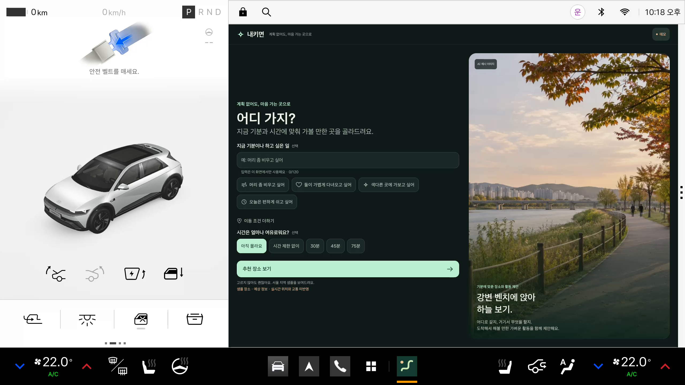

# 내키면

**계획 없어도, 마음 가는 곳으로.** 현재 위치와 지금 하고 싶은 일에서 출발해 갈 곳과 해 볼 활동을 고르고, 확인한 목적지를 Pleos 내비로 전달하는 차량용 즉흥 외출 앱입니다.

내키면은 목적지를 정하지 않고 차에 오른 날, 지금 기분과 여유 시간에 맞춰 갈 곳과 그곳에서 해볼 일을 제안하는 Pleos Connect 앱입니다.

약속까지 45분 남았다면 출발한 곳으로 돌아올 시간을 고려해 후보를 살펴보세요. 둘이 나선 드라이브에선 ‘둘이 가볍게 다녀오고 싶어’를 골라 함께 할 일을 찾아보세요. 하루가 통째로 비었다면 ‘시간 제한 없이’ 시작할 수 있습니다.



정차 중에는 장소와 활동을 나란히 비교할 수 있습니다. 고르기 어려우면 **‘하나만 바로 추천받기’**를 누르세요. 주행 중에는 한 곳씩 살펴보고, 마음에 드는 목적지의 안내 버튼을 누르면 차량 내비로 이어집니다.

[외출 장소 고르는 영상](demo/naekimyeon-demo.mp4) · [주행 화면 영상](demo/naekimyeon-driving.mp4)

## 설치하고 실행하기

[공모전 제출 APK 다운로드](apk/설우현_내키면_release.apk) · 0.2.0-demo · 서울 지역 예시 장소 3곳으로 체험

Pleos Connect 에뮬레이터를 부팅한 뒤 저장소 루트에서 실행하세요. 계정이나 API 키는 필요하지 않습니다. 여러 기기가 연결돼 있으면 각 명령의 `adb` 뒤에 `-s 기기번호`를 붙이세요.

```powershell
adb install -r "apk/설우현_내키면_release.apk"
adb shell am start -n com.naekimyeon.pleos/.MainActivity
```

**테스트 환경**　Pleos Connect Emulator 2.1.0 · Android 14 (API 34, x86_64) · 2560 × 1440 px, 160 dpi

**소스 빌드**　Android Studio에서 JDK 21과 Android SDK Platform 36을 설정한 후 `.\gradlew.bat :app:assembleDebug`를 실행하세요.

[현재 위치로 주변 공원을 찾는 0.3 프리뷰](https://github.com/dev-whseol/naekimyeon-pleos/tree/improve/location-aware)
