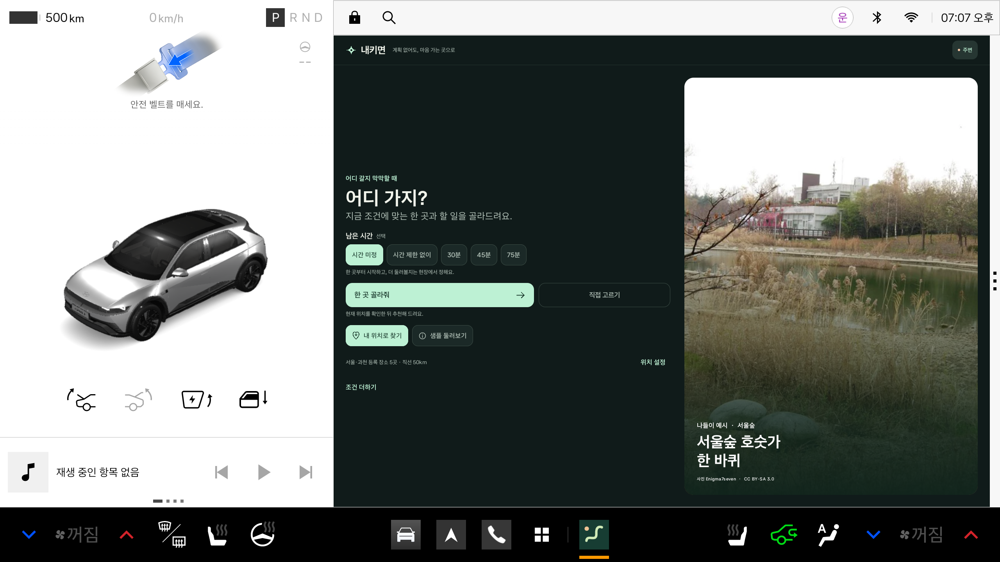

# 내키면

**계획 없어도, 마음 가는 곳으로.**

갈 곳을 정하지 않고 차에 오른 날, 지금 남는 시간에 맞춰 장소 하나와 거기서 해볼 일을 골라주는 Pleos Connect 앱입니다.

밥 먹고 다음 약속까지 45분이 비었다면 **45분 → 한 곳 골라줘**를 눌러 보세요. 잠깐 바람을 쐬고 싶은 날엔 서울숲 거울연못에 들르고, 둘이 실내에 가고 싶은 날엔 서울역사박물관의 서울 모형에서 서로 아는 동네를 찾아볼 수 있어요. **시간 제한 없이**를 고르면 같은 장소에서 이어서 들를 곳도 제안합니다.



[38초 영상으로 보기](demo/outing-0.4.mp4) · [한 곳 추천 화면](demo/screenshots/outing-0.4/pick.png)

- **어디든 괜찮을 때**　‘한 곳 골라줘’를 누르면 한 곳만 나옵니다. 남는 시간이 45분 이하고 후보가 세 곳 이상이면 첫 추천은 가까운 두 곳 중에서 고릅니다. ‘다른 곳 보기’를 누르면 같은 조건의 후보를 한 바퀴 돌 때까지 겹치지 않습니다.
- **하고 싶은 게 있을 때**　바람을 쐴지, 실내에 들를지 고르거나 기분을 적어 보세요. 정차 중에는 후보를 비교하고, 주행 중에는 한 곳씩 확인할 수 있습니다.

## APK와 실행 방법

[최신 APK · 0.4](apk/preview/naekimyeon-0.4.0-preview-release.apk) · [공모전 제출 APK · 0.2](apk/설우현_내키면_release.apk) · [제출 당시 시연 영상](demo/naekimyeon-demo.mp4)

Pleos Connect 에뮬레이터를 부팅한 뒤 저장소 루트에서 실행하세요.

```powershell
adb install -r "apk/preview/naekimyeon-0.4.0-preview-release.apk"
adb shell am start -n com.naekimyeon.pleos/.MainActivity
```

| 항목 | 설정 |
| --- | --- |
| 테스트 환경 | Pleos Connect Emulator 2.1.0 · Android 14 (API 34, x86_64) |
| 화면 규격 | 2560 × 1440 px, 160 dpi |
| 주변 추천 | 에뮬레이터 위치를 서울·과천 인근으로 설정하고 앱에서 위치 사용을 허용하세요. 위치 설정 없이 살펴보려면 ‘샘플 둘러보기’를 고르세요. |
| 소스 빌드 | JDK 21 · Android SDK Platform 36 · `.\gradlew.bat :app:assembleDebug` |

현재 둘러볼 곳은 서울숲, 월드컵공원, 서울대공원, 서울역사박물관, 국립과천과학관입니다. 이 중 현재 위치에서 직선거리 50km 안에 있는 장소를 추천합니다. 왕복 소요 시간과 주차 가능 여부는 출발 전에 확인하세요.
