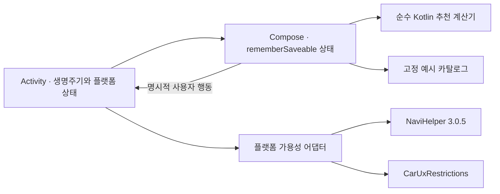

# 0.3 현재 구조

기존 화면·추천 계산·차량 어댑터 경계에 전경 위치와 실제 자료를 추가했다.

- `domain/NearbyPlaces.kt`: 좌표 검증, 위치 신선도·오차 정책, 순수 직선거리·반경 필터. Android 의존성이 없다.
- `domain/CuratedPlaces.kt`: 출처·조회일·주소·대표점 주의사항을 가진 소규모 실제 공원 카탈로그. 기존 `DemoPlaces`와 섞지 않는다.
- `domain/SceneRecommender.kt`: 특정 예시 ID에 묶이지 않은 기분 순위. 실제 후보는 거리 구간 안에서 편집 우선순위와 거리로 정렬한다.
- `platform/ForegroundLocationAdapter.kt`: 권한 확인 후 전경 위치 취득, 세대 번호로 지연 응답 폐기, 타임아웃·만료·취소. 좌표는 메모리에만 유지한다.
- `MainActivity`: 명시적 위치 사용·권한 UI·전경 갱신 수명, 기존 안전·Gleo·내비 경계. 위치 허용 후 센서 갱신과 권한 팝업은 구별한다.
- `ui/DiscoverySourcePanel.kt`, `PlacePresentation.kt`: 실제/샘플 모드, 상태 복구, 직선거리·ETA 미확인·출처 표시. 원본 좌표를 UI 상태 저장소에 보관하지 않는다.

Android 전경 위치 제공자와 Pleos FusedLocation은 교체 가능한 플랫폼 경계로 확장할 대상이다. 이번 구현이 Pleos 전용 위치 SDK를 연결했다고 주장하지 않는다. 실제 경로 시간은 아직 연결하지 않았으며, 미확인 값을 추정치로 바꿔 넣지 않는다.

[자료 범위](DATA_SOURCES.md) · [개선 검증](UPGRADE_TESTS.md)

---

아래는 0.2 제출 당시 기반 구조다. 고정 예시·위치 미사용·당시 테스트 수 설명은 **0.2에 한정**하며 현재 범위는 위와 같다.

# 아키텍처

이 문서는 내키면의 책임 경계와 확장 방침을 설명합니다. 소스에 구현한 어댑터와 대상 환경에서 검증한 기능은 구분합니다. 실행 여부와 실측 결과는 [테스트 기록](TEST_PLAN.md)을 기준으로 판단합니다.

## 제품과 데이터의 경계

내키면은 별도 계획이 없는 순간의 마음·상황에 맞는 후보를 비교하고 선택하는 앱입니다. 시간은 선택 조건이며 미정·무제한·정해진 시간을 구분합니다. 앱이 자체 내비게이션 경로를 계산하거나 차량을 제어하지 않습니다. 공모전 시연은 작은 고정 데이터 집합으로 재현할 수 있도록 구성합니다. 고정 예시로 계산한 이동·체류·복귀 시간은 실시간 교통, 날씨, 영업, 주차 가능 상태의 검증값이 아닙니다.

실서비스에서는 장소 데이터, 경로 예상 시간, 차량 상태가 서로 다른 수명과 실패 조건을 가집니다. 현재 화면은 고정 예시 카탈로그와 순수 Kotlin 계산기를 직접 사용하며, 플랫폼 SDK는 별도 어댑터에 둡니다. 데이터 제공자가 추가될 때 출처·시각·가용 상태를 반환하는 repository 경계를 도입할 수 있습니다.

## 책임 분리

| 영역 | 책임 | 포함하지 않을 책임 |
| --- | --- | --- |
| Compose UI | `rememberSaveable`로 선택·화면 상태 관리, 상태 표시, 창 크기에 따른 배치 | API 키, 직접 SDK·네트워크 호출, 추천 계산 규칙 |
| Activity | 플랫폼 상태 전달, 명시적 행동 처리, 어댑터 생명주기 소유 | 추천 계산 규칙, 개인정보 로그 |
| 도메인 | 입력 검증, 시간 예산·후보 계산의 결정적 규칙 | Android UI, 실제 위치 취득 |
| 고정 예시 카탈로그 | 재현 가능한 3개 장소와 샘플 출처 | 실제처럼 보이는 임의 실시간 정보 |
| Capability adapter | 내비·차량 상태의 지원/제한/실패 구분 | UI의 무조건 성공 처리, 권한 우회 |

현재는 단일 Gradle 모듈, Compose의 복원 가능한 화면 상태, 순수 Kotlin 도메인, 생명주기를 소유하는 Activity로 구성한 작은 프로토타입입니다. **ViewModel과 repository 계층은 아직 도입하지 않았습니다.** UI가 플랫폼 상태를 받고 사용자 행동을 Activity에 전달하는 방향은 유지합니다. 비동기 데이터·영속 설정·여러 화면의 공유 상태가 추가되면 ViewModel과 repository로 상태·데이터 소유권을 옮기고 대체 구현을 주입합니다. 처음부터 다수의 모듈·서비스·DI 프레임워크를 필수로 만들지 않습니다.

## 현재 도메인 모델

`domain/Place.kt`는 시간의 미설정·무제한·제한 상태, 복귀 기준, 주차 시설 존재와 빈자리 가용성을 서로 다른 타입으로 표현합니다. `RecommendationEngine`은 조건에 맞는 예시 후보를 최대 3개로 제한합니다. 정해진 시간과 같은 출발점으로의 복귀가 모두 선택되었을 때만 이동·복귀·접근·여유 시간을 제외해 체류 시간을 계산합니다. 필요한 예상값이 없거나 최소 체류 시간을 확보하지 못하면 적합한 후보로 통과시키지 않습니다.

`DemoPlaces`의 3개 항목은 샘플 출처를 함께 가지며, 실제 위치를 조회하지 않습니다. 주차 시설이 있는 예시도 빈자리 상태는 `UNKNOWN`입니다. 실시간 교통·영업·주차·날씨 제공자는 현재 구현 범위에 없습니다.

`MoodInterpreter`는 120자 이내의 명시적 표현을 네 가지 마음 유형에 연결합니다. 비어 있음과 모르는 표현을 구별하고, 점수가 같은 복합 표현이나 지원하는 부정 표현은 임의 판단하지 않습니다. `SceneRecommender`는 먼저 기존 시간·활동 조건으로 적합성을 확인한 뒤 마음별 순서·활동·이유를 부여합니다. `ScenePicker`는 이 적합 후보 안에서 하나를 고르고 두 곳 이상이면 직전 장소를 피합니다. UI에서는 ‘하나만 바로 추천받기’로 표시하며 내비게이션을 호출하지 않습니다.

`platform/NaviAdapter.kt`는 실제 NaviHelper 3.0.5를 사용합니다. 목적지는 좌표 범위와 이름을 검사한 뒤 명시적 호출로 전달합니다. `RouteConfirmationGate`는 새 경로 시작/완료 이후의 목적지 응답과 완료 또는 `ROUTE_DRIVE`를 조합하며, 이전 경로의 취소·오래된 readback만으로 성공을 표시하지 않습니다. 현재 좌표 비교에는 위도·경도 각각 0.001도의 허용 오차가 있으므로 정확한 출입구 일치를 보증하지 않습니다. 공식 2.1.0 에뮬레이터에서 실제 내비 반영과 앱의 확인 상태를 검증했습니다.

내비 연결 기한은 10초, 요청 확인 기한은 30초입니다. 요청 중에는 1초 후 시작해 2초 간격으로 읽기 전용 목적지·상태 확인을 하며, 성공·실패·기한 초과·종료 시 멈춥니다. `RouteStateInfo.isRouting`은 시험 provider에서 안내 상태와 일치하지 않아 진단에만 사용합니다. 요청 전달 자체는 성공으로 간주하지 않고, 기한 초과가 목적지 미변경을 의미하지도 않습니다. 종료 시 리스너와 SDK 자원을 해제합니다.

`platform/DrivingSafetyAdapter.kt`는 실제 AAOS 제한 상태를 읽고, 서비스·권한·플랫폼을 사용할 수 없으면 제한 상태를 유지합니다. 위치·기어·속도로 주차 여부를 임의 추정하지 않습니다. UI와 내비 호출은 이 상태를 함께 적용해야 합니다.

`platform/GleoBridge.kt`와 `assets/schema.json`은 Gleo의 intent 계약을 준비합니다. 알려진 활동 종류 또는 120자 이내의 마음 문구 중 하나가 필요하며, 시간은 1~240분의 정수, JSON 문자열은 최대 4,096자로 제한합니다. 정해진 시간과 무제한이 함께 오거나 마음을 연결하지 못하면 추가 확인 상태로 처리합니다. 원문은 콜백 payload·진단 문자열에 포함하지 않습니다. 수신 행동은 샘플 후보 화면을 준비하는 범위이며 자동 내비 시작은 허용하지 않습니다. 공식 스키마 승인·Gleo 실제 음성 호출은 별도 검증입니다.

## 상태와 실패 처리

- 플랫폼 상태는 Activity에서 화면으로 전달하고 내비 요청은 콜백으로 되돌려 보냅니다. 로딩, 빈 후보, 선택 완료, 기능 미지원, 오류를 성공 상태와 구분합니다.
- 시간 선택·취향 선택·후보 선택·일시적 피드백은 `rememberSaveable` 세션 상태입니다. Android가 저장한 화면 상태의 복원 범위와 새 작업의 시작은 구분하며, 영속적인 방문 이력이나 계정 프로필은 저장하지 않습니다. 복원·초기화 동작은 실제 실행으로 확인합니다.
- SDK 연결 결과를 받기 전에 완료 문구를 표시하지 않습니다. 시연용 완료는 시연임을 표시하고 실제 목적지 설정 완료와 구분합니다.
- 실제 연동은 `unsupported`, `permission denied`, `disconnected`, `timeout`, `failed`, `success`를 처리할 수 있어야 합니다. 앱 복귀 때 차량·주행 제한 상태를 다시 확인합니다.
- 비동기 작업은 화면 생명주기와 취소에 맞추고, 오래된 응답이 더 최근 선택을 덮어쓰지 않도록 합니다. 파일·네트워크 작업은 메인 스레드 밖에서 수행합니다.

## 차량 환경

Pleos는 앱 창의 분할·확장으로 표시 영역이 바뀌므로 전체 패널 크기만으로 UI를 설계하지 않습니다. 가로 화면과 좁은 세로 창에서 핵심 조작을 유지하고 시스템 UI의 가림 영역을 고려합니다. 화면 밖으로 나갔다고 프로세스가 종료되는 것은 아니므로 복귀 시 상태를 확인하고 불필요한 백그라운드 갱신은 멈춥니다. [공식 화면·생명주기 모델](https://document.pleos.ai/docs/pleos-only/vehicle-app-planning-guide/app-structure-screen-model)

실제 주행 제한은 `CarUxRestrictions`를 기준으로 판단합니다. 데모 토글이나 속도 고정값은 이 API 연동을 대신하지 않습니다. 지원 여부를 확인할 수 없으면 출발·상세 조작 등 해당 기능을 안전하게 제한하는 방침을 적용하고, 주행 중 사용이 인증되었다고 표시하지 않습니다. [공식 주행 안전 가이드](https://document.pleos.ai/docs/pleos-only/vehicle-app-planning-guide/driver-distraction-guideline)

Vehicle SDK 등의 기능 지원은 차량 모델명만으로 추정하지 않고 capability 응답과 권한 상태를 확인해야 합니다. 내비게이션 탑재 여부·SDK 지원·사용자 승인·호출 결과가 모두 확인되기 전에는 내비 목적지 적용 성공을 주장하지 않습니다. [공식 API 가용성 가이드](https://document.pleos.ai/docs/pleos-only/vehicle-app-planning-guide/api-compatibility-availability)

## 성능 방침

시작 시 작은 예시 데이터를 읽고 초기 화면에 필요한 작업만 합니다. 화면당 표시 후보 수를 제한하고, 지속 타이머·반복 애니메이션·네트워크 폴링을 추가하지 않습니다. 연속 입력은 중복 실행하지 않고 진행 상태를 즉시 표시합니다. 일반 UI 동작, 시작 시간, 메모리·CPU는 release APK에서 측정해야 하며 코드 구조만으로 성능 충족을 선언하지 않습니다.

실서비스 네트워크 연동에는 응답 제한, 타임아웃·취소, 캐시 만료, 최신성 표시가 필요합니다. 통신 실패 시 이전 데이터를 정상 실시간 정보처럼 표시하지 않으며 사용자가 다시 시도할 수 있게 합니다.

## 후속 개발 조건

실차 및 다양한 provider 검증, ViewModel·repository 도입, 장소·교통 데이터 갱신, 위치 권한, Gleo 음성 호출의 공식 승인과 실행, 사용자 설정 저장은 각각 후속 검증·개발이 필요한 범위입니다. Gleo Android 연동 테스트 27개 통과만으로 실제 음성 기능이 활성화되었다고 설명하지 않습니다. 구현 여부는 README에 명시하고 현재 오프라인 추천 시연에서 성공한 것처럼 묶어서 설명하지 않습니다.
